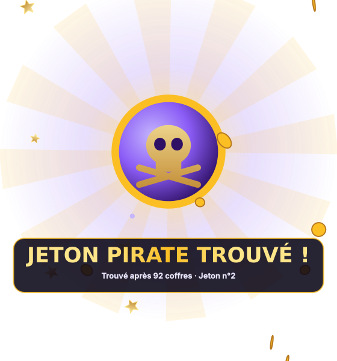
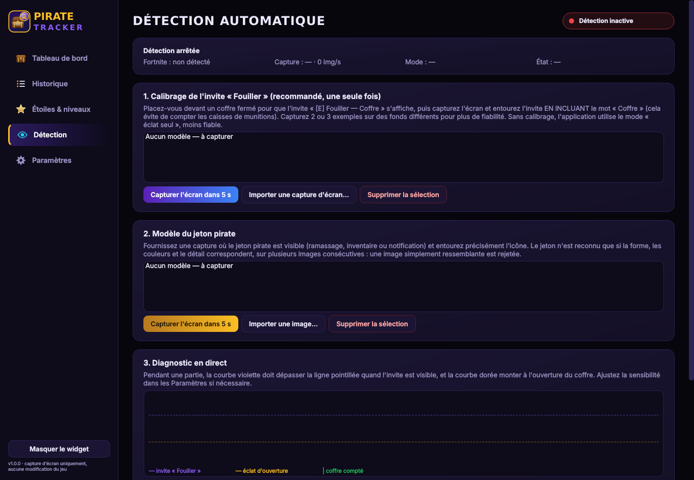

# 🏴‍☠️ Pirate Tracker — compteur automatique de coffres Fortnite

Application Windows qui **compte automatiquement** les coffres que vous ouvrez dans Fortnite,
**détecte le jeton pirate** quand il apparaît à l'écran, et affiche vos statistiques en direct
dans un **mini-widget flottant** au-dessus du jeu. Aucun bouton à presser pour compter.


| Widget en jeu | Jeton trouvé |
|---|---|
|  |  |

---

## Sommaire
1. [Installation](#installation)
2. [Premier lancement : calibrage (2 minutes)](#premier-lancement--calibrage-2-minutes)
3. [Comment fonctionne la détection](#comment-fonctionne-la-détection)
4. [Ce qui a été testé — et ce qui ne l'a pas été](#ce-qui-a-été-testé--et-ce-qui-ne-la-pas-été)
5. [Limites connues et solutions](#limites-connues-et-solutions)
6. [Anti-triche : pourquoi c'est sans risque](#anti-triche--pourquoi-cest-sans-risque)
7. [Fonctionnalités](#fonctionnalités)
8. [Développement](#développement)

---

## Installation

### Option A — installateur `.exe` (recommandé)
1. Onglet **Actions** du dépôt GitHub → dernière exécution réussie de **Windows build**.
2. Téléchargez l'artefact **PirateTracker-Windows** (zip).
3. Lancez `PirateTracker-Setup-1.0.0.exe` (aucun droit administrateur requis).
   Une version portable (`PirateTracker-portable.zip`) est aussi fournie.

> Windows SmartScreen peut afficher « Windows a protégé votre ordinateur » car l'exécutable
> n'est pas signé numériquement : cliquez sur *Informations complémentaires → Exécuter quand même*.

### Option B — depuis le code source
```bat
py -3.12 -m pip install -r requirements.txt
py -3.12 -m pirate_tracker
```

---

## Premier lancement : calibrage (2 minutes)

La détection fiable a besoin de **voir une fois** l'invite d'interaction de *votre* jeu
(langue, résolution et taille d'interface varient d'un joueur à l'autre).

1. Lancez Pirate Tracker, puis Fortnite en mode **« Plein écran fenêtré »** (*Windowed Fullscreen*).
2. En jeu (mode Créatif ou partie normale), placez-vous **devant un coffre fermé** pour que
   l'invite **« [E] Fouiller — Coffre »** s'affiche.
3. Dans Pirate Tracker → **Détection** → **« Capturer l'écran dans 5 s »**, puis revenez
   dans Fortnite. Après 5 secondes, l'écran est capturé.
4. Entourez l'invite **en incluant le mot « Coffre »** (sinon les caisses de munitions,
   qui ont aussi « Fouiller », seraient comptées). Enregistrez.
5. Recommencez 1 ou 2 fois sur un décor différent (jour/nuit, intérieur/extérieur).
6. **Jeton pirate** : dès que vous disposez d'une capture où le jeton est visible
   (ramassage, inventaire, image officielle à la même échelle…), importez-la et entourez l'icône.

L'indicateur passe alors au 🟢 **Détection active**. Ouvrez quelques coffres et regardez la
section *Diagnostic en direct* : la courbe violette dépasse la ligne quand l'invite est
visible, la courbe dorée monte à l'ouverture, et un trait vert marque chaque coffre compté.

**Vérification recommandée avant de vous y fier** : enregistrez 5–10 minutes de partie
(Xbox Game Bar : `Win + Alt + R`) et analysez-la dans *Détection → Tester sur une vidéo*,
ou en ligne de commande avec comparaison à la réalité :

```bat
py tools\validate_video.py partie.mp4 --truth instants_reels.txt
```
(`instants_reels.txt` : un instant d'ouverture réel par ligne, ex. `01:23.5`). L'outil donne
la **précision** (pas de faux coffres) et le **rappel** (pas de coffres oubliés).

---

## Comment fonctionne la détection

### Coffres — mode « invite + éclat » (par défaut)
Un coffre n'est compté que si trois indices se succèdent :

1. **L'invite « Fouiller — Coffre » est reconnue** (corrélation de forme sur une petite zone,
   puis vérification cellule par cellule — c'est ce qui distingue « Coffre » de
   « Caisse de munitions »), pendant au moins 0,2 s.
2. **L'invite disparaît** : un coffre ouvert n'a plus d'invite. C'est ce qui empêche de
   **confondre un coffre fermé et un coffre ouvert** et de **compter deux fois le même coffre**.
3. **Un éclat doré apparaît au centre** dans la seconde qui suit (animation d'ouverture).
   La lueur permanente d'un coffre *fermé* est absorbée par une ligne de base lente : seul un
   *saut* soudain compte.

Si l'invite disparaît sans éclat (vous vous éloignez), rien n'est compté. Après chaque coffre,
un délai anti double-comptage (2,5 s, réglable) s'applique.

### Coffres — mode « éclat seul » (sans calibrage)
Solution de repli tant que l'invite n'est pas calibrée : seul l'éclat doré est utilisé, avec
un seuil plus strict. **Moins fiable** (une explosion dorée au centre de l'écran peut être
comptée) : l'indicateur reste 🟠 tant que ce mode est utilisé par défaut.

### Jeton pirate
Quatre vérifications indépendantes doivent **toutes** réussir :
forme (multi-échelle, 0,5× à 2×), **couleurs** (histogramme teinte/saturation + écart de
couleur moyen), **détail fin**, puis **persistance** (≥ 3 des 5 dernières analyses).
Une image de même forme mais d'une autre couleur, une simple pièce, ou un jeton aperçu une
fraction de seconde sont rejetés. Une capture d'écran annotée est enregistrée à chaque découverte.

### Ressources
Analyse à 15 images/s en résolution réduite : ~8 ms par image pour les coffres
(≈ 12 % d'un cœur CPU), ~55 ms par analyse du jeton à 3 analyses/s (≈ 17 % d'un cœur,
moins si vous réduisez la zone). La détection se met en pause quand Fortnite n'est pas lancé
ou n'est pas au premier plan.

---

## Ce qui a été testé — et ce qui ne l'a pas été

Conformément à votre exigence de ne rien prétendre sans test, voici l'état exact :

| Élément | Statut |
|---|---|
| Logique de détection des coffres (ouverture, éloignement sans ouverture, coffre fermé seul, explosion, deux coffres, invite qui scintille, éclat + butin doré, **caisse de munitions**) | ✅ Testé sur **séquences synthétiques** imitant le jeu (`tests/test_chest_detection.py`) |
| Jeton : vrai jeton à 3 échelles, **sosie recoloré rejeté**, **pièce ordinaire rejetée**, apparition furtive rejetée, ré-armement | ✅ Testé sur séquences synthétiques (`tests/test_token_detection.py`) |
| Chaîne complète vidéo → détecteurs → base → widget mis à jour en direct | ✅ Testé (`tests/test_pipeline_and_ui.py`, application réelle sans écran) |
| Sauvegarde : persistance après fermeture brutale, export CSV/JSON, sauvegarde/restauration, réinitialisation | ✅ Testé (`tests/test_storage_and_tracker.py`) |
| Tests, capture d'écran et démarrage de l'`.exe` **sous Windows** | ✅ Vérifiés automatiquement par la CI GitHub (`windows-latest`) |
| **Détection sur de vraies images de Fortnite** | ❌ **Non testé** : l'environnement de développement n'avait ni Windows, ni Fortnite, ni enregistrement réel du jeu. Les seuils par défaut sont des estimations ; utilisez le diagnostic en direct et `validate_video.py` pour les valider sur votre machine. |
| Apparence exacte du jeton pirate | ❌ Inconnue au moment du développement : **aucun modèle n'est fourni**, il doit être capturé/importé (voir calibrage). |

Si la détection se révèle imparfaite sur vos parties, envoyez une courte vidéo et le fichier
de vérité : les seuils (sensibilité, seuil de l'invite) sont réglables sans modifier le code.

---

## Limites connues et solutions

| Situation | Effet | Solution |
|---|---|---|
| Fortnite en **plein écran exclusif** | Le widget peut ne pas s'afficher par-dessus le jeu ; la capture GDI peut être noire | Mode **Plein écran fenêtré** dans Fortnite (aucune perte de performance notable sur Windows 10/11). L'application l'indique (« Image noire… »). |
| Invite non calibrée | Mode éclat seul, moins fiable | Faire le calibrage (2 min) |
| Changement de langue, de résolution ou d'échelle HUD | L'invite n'est plus reconnue | Recapturer un modèle d'invite |
| Coffre ouvert par un coéquipier / coffre déjà ouvert | Non compté (aucune invite pour vous) | Comportement voulu : seuls *vos* coffres comptent |
| Écran occupé par un menu au moment exact de l'ouverture | Coffre potentiellement manqué | Rare ; vérifiable dans l'historique |
| Faux positif ponctuel | +1 en trop | *Détection → Annuler le dernier coffre* |
| Plusieurs écrans | Mauvais écran capturé | *Paramètres → Écran du jeu* |

---

## Anti-triche : pourquoi c'est sans risque

Pirate Tracker fonctionne **exactement comme un logiciel d'enregistrement vidéo** (OBS, Xbox
Game Bar, Discord) :
- il **lit uniquement l'image affichée** via les API Windows standard (DXGI Desktop
  Duplication ou GDI) ;
- il **ne lit pas** la mémoire du jeu, **n'injecte aucun code**, ne modifie **aucun fichier**
  du jeu et **n'envoie aucune entrée** (clavier/souris) au jeu ;
- il consulte la liste des processus (comme le Gestionnaire des tâches) pour savoir si
  Fortnite est lancé et au premier plan ;
- le widget est une fenêtre Windows ordinaire « toujours au premier plan ».

Aucune automatisation du gameplay n'est faite : l'application observe, elle n'agit pas.

---

## Fonctionnalités

- **Détection automatique** des coffres et du jeton pirate, statut 🟢/🟠/🔴.
- **Widget flottant** transparent, déplaçable (glisser), toujours au premier plan, 3 tailles,
  5 positions + position libre, opacité réglable, clic droit pour le menu, double-clic pour
  le tableau de bord. Affiche coffres, jetons, niveau (5 étoiles), coffres depuis le dernier
  jeton, barre de progression.
- **Tableau de bord** : total, jetons, depuis le dernier jeton, aujourd'hui, session en cours,
  record, temps de jeu suivi, courbe de progression (avec les jetons), coffres par jour et par session.
- **Étoiles & niveaux** : 5 étoiles par niveau, paliers personnalisables, animations, historique.
- **Historique** de toutes les sessions (date, durée, coffres, jetons, coffres depuis le dernier
  jeton) et des jetons trouvés (avec capture d'écran).
- **Notifications** (coffre, jeton, étoile/niveau, record) et **sons** personnalisables
  (fichiers `.wav`), activables séparément.
- **Célébration plein écran** lorsqu'un jeton est trouvé.
- **SQLite local**, sauvegarde automatique toutes les 30 min et à la fermeture (10 dernières
  conservées), export CSV/JSON, sauvegarde/restauration manuelle, réinitialisation.
- Icône près de l'horloge : fermer la fenêtre ne coupe pas le comptage.
- Lancement au démarrage de Windows (option).

Données : `%APPDATA%\PirateTracker\` (base, réglages, modèles, captures, sauvegardes).




---

## Développement

```
pirate_tracker/
  detection/chest.py    détecteur de coffres (invite + disparition + éclat, machine à états)
  detection/token.py    détecteur de jeton (forme multi-échelle, couleur, détail, persistance)
  capture.py            capture d'écran DXGI / GDI / vidéo
  engine.py             boucle de détection (thread) + analyse de vidéo
  tracker.py            sessions, compteur, niveaux, records
  database.py           SQLite
  ui/                   PySide6 : widget, tableau de bord, effets, paramètres
tests/                  tests + générateur de scènes synthétiques
tools/validate_video.py validation sur enregistrements réels (précision / rappel)
packaging/              PyInstaller + Inno Setup
```

```bash
pip install -r requirements-dev.txt
QT_QPA_PLATFORM=offscreen python -m pytest -q        # tests
python -m pirate_tracker --video partie.mp4          # rejouer une vidéo dans l'application
pyinstaller packaging/pirate_tracker.spec --noconfirm # construire l'exe (sous Windows)
```

*Projet de fan non affilié à Epic Games. Fortnite est une marque d'Epic Games, Inc.
Toutes les illustrations de l'application sont dessinées en code.*
