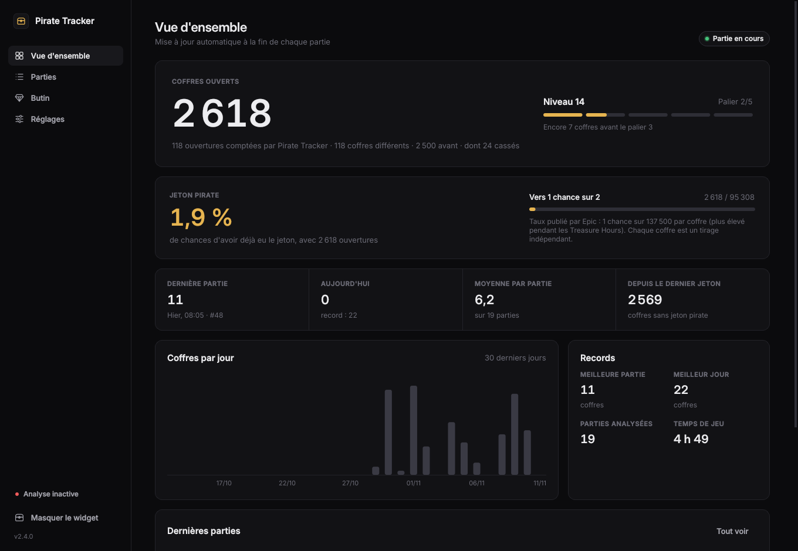
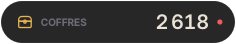
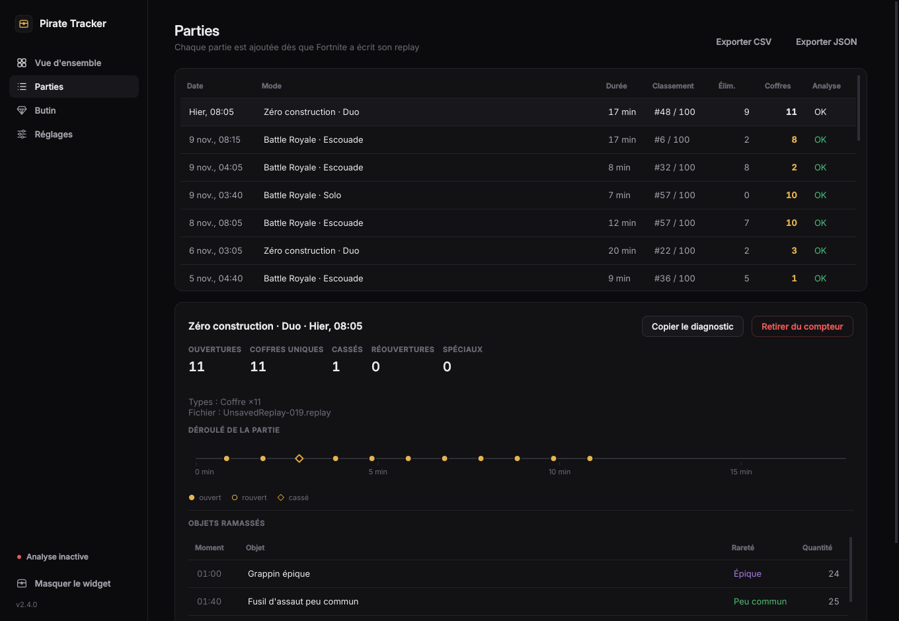
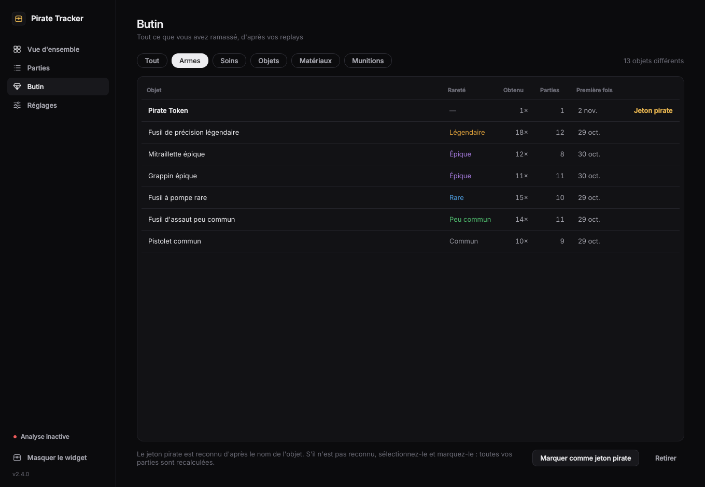
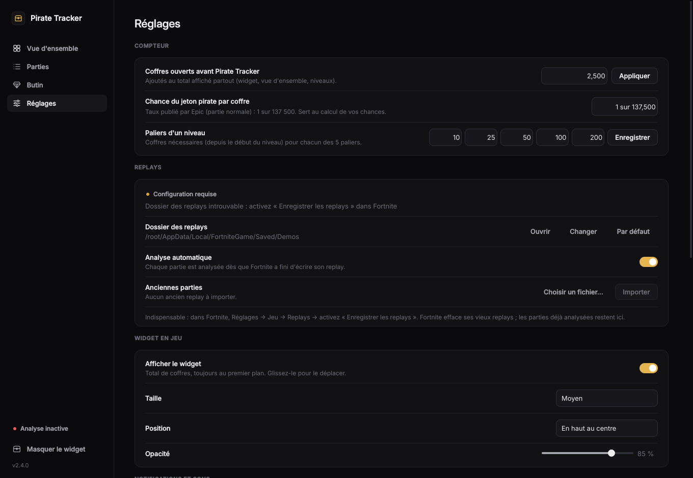
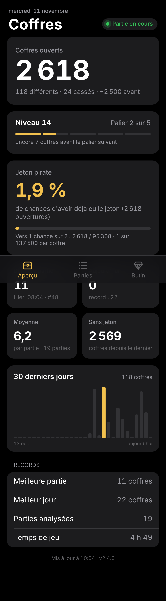
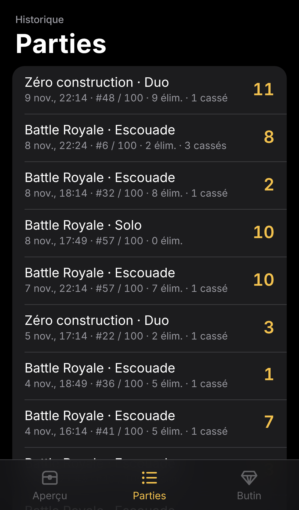

# Pirate Tracker — compteur automatique de coffres Fortnite

Pirate Tracker compte **tout seul** les coffres que vous ouvrez dans Fortnite, en lisant les
**replays** que le jeu enregistre à la fin de chaque partie. Le total de coffres ouverts s'affiche
dans un petit widget au-dessus du jeu et se met à jour **à la fin de chaque partie**. Une page
complète montre vos statistiques : coffres de la dernière partie, total, historique, récompenses
obtenues.

Aucun bouton à presser, aucune capture d'écran, aucune interaction avec le jeu.



| Widget pendant la partie | Notification de fin de partie |
|---|---|
|  |  |

---

## Installation

Téléchargement direct (dernière version, sans compte GitHub) :
**[PirateTracker-Setup.exe](https://github.com/westerferdinand-del/-Fortnite-Pirate-Tracker/releases/download/latest/PirateTracker-Setup.exe)**
— aucun droit administrateur requis. Version portable :
[PirateTracker-portable.zip](https://github.com/westerferdinand-del/-Fortnite-Pirate-Tracker/releases/download/latest/PirateTracker-portable.zip).

Installation ou mise à jour en une commande (Windows + R → `powershell` → coller) :

```powershell
[Net.ServicePointManager]::SecurityProtocol=[Net.SecurityProtocolType]::Tls12; $ProgressPreference="SilentlyContinue"; Stop-Process -Name PirateTracker,PirateReplayReader -Force -ErrorAction SilentlyContinue; $f="$env:TEMP\PirateTracker-Setup.exe"; Invoke-WebRequest "https://github.com/westerferdinand-del/-Fortnite-Pirate-Tracker/releases/download/latest/PirateTracker-Setup.exe" -OutFile $f -UseBasicParsing; Start-Process $f -ArgumentList "/SILENT","/SUPPRESSMSGBOXES","/NORESTART" -Wait; Start-Process "$env:LOCALAPPDATA\Programs\PirateTracker\PirateTracker.exe"
```

> Windows SmartScreen peut afficher « Windows a protégé votre ordinateur » car l'exécutable n'est
> pas signé : *Informations complémentaires → Exécuter quand même*.

## ⚠️ Étape indispensable : activer les replays dans Fortnite (une seule fois)

1. Fortnite → menu (en haut à droite) → **Réglages** ⚙.
2. Onglet **Jeu** → section **Replays**.
3. Activez **« Enregistrer les replays »** (*Record Replays*). Sur PC, activez aussi l'option
   Battle Royale si elle est proposée.

Ensuite, jouez normalement. À la fin de chaque partie, Fortnite écrit le replay dans
`%LOCALAPPDATA%\FortniteGame\Saved\Demos`. Pirate Tracker l'analyse (environ 2 secondes) et met
à jour le widget, avec une notification « +N coffres cette partie ».

Vos parties d'avant l'installation peuvent être importées : page **Replays → Importer les anciens
replays**, tant que Fortnite ne les a pas encore effacées.

---

## Comment ça marche

Un replay Fortnite contient les données réseau de la partie. Pour chaque coffre, le jeu enregistre
**qui l'a fouillé** (`SearchingPawn`). Pirate Tracker :

1. repère **votre** personnage, c'est-à-dire celui du joueur qui a enregistré le replay ;
2. compte les coffres **ouverts ou cassés** par votre personnage, **une seule fois chacun**,
   y compris les **coffres spéciaux** : toute variante de coffre est reconnue automatiquement,
   même nouvelle. Les coffres de vos coéquipiers ou des adversaires ne comptent pas, pas plus
   que les caisses de munitions ou les meubles fouillables ;
3. relève les objets que vous avez ramassés (page Butin) et détecte le **jeton pirate**
   d'après le nom de l'objet.

Garde-fous contre les erreurs de comptage :
- un replay n'est jamais lu pendant la partie, seulement quand Fortnite a fini de l'écrire
  (fichier stable 30 s, et marqué terminé) ;
- si un replay déjà compté change, la partie est **remplacée**, jamais comptée deux fois ;
- **partie quittée ou jeu fermé en pleine partie** : le replay coupé est quand même lu, et les
  coffres ouverts avant la coupure sont comptés (mention « Replay incomplet ») ;
- un résultat suspect (aucun coffre reconnu, joueur non identifié) est signalé « À vérifier » au
  lieu d'annoncer « 0 coffre » ;
- un replay illisible est signalé et ne compte rien.

Pendant que vous jouez, l'application ne fait rien d'autre qu'attendre, donc elle ne consomme rien.

### Vos chances pour le jeton pirate

La vue d'ensemble (et l'application mobile) calcule la probabilité d'avoir déjà obtenu le jeton
avec vos ouvertures, d'après le taux publié par Epic : 1 chance sur 137 500 par coffre en partie
normale (modifiable dans Réglages). Chaque coffre est un tirage indépendant : la probabilité
cumulée dit seulement à quel point il était probable d'en avoir eu au moins un. 1 chance sur 2 est
atteinte à 95 308 ouvertures.

### Le jeton pirate

Le nom interne exact de l'objet « jeton pirate » dans les fichiers du jeu n'était pas connu pendant
le développement. Il est reconnu automatiquement si son nom contient *pirate* avec *token / coin /
doubloon / medal*. Sinon, ouvrez la page **Butin**, sélectionnez l'objet et cliquez sur
**« Marquer comme jeton pirate »** : toutes vos parties sont recalculées. À chaque découverte : une
notification Windows (« JETON PIRATE TROUVÉ ! Après N coffres ») et un son, sans animation ; les
deux se désactivent dans les Réglages. Le nombre de jetons trouvés n'est volontairement pas
affiché.

---

## Ce qui a été testé — et ce qui ne l'a pas été

| Élément | Statut |
|---|---|
| Comptage sur un **vrai replay Fortnite** (Chapitre 5, v32.00, novembre 2024) : 5 coffres pour le joueur, sur 86 ouverts dans la partie, y compris 2 coffres qui disparaissent après ouverture | ✅ Testé (`tests/test_replays.py`), sous Linux et dans la CI Windows |
| Chaîne complète : replay déposé dans le dossier → attente de fin d'écriture → analyse → 5 coffres en base, sans double comptage | ✅ Testé, y compris avec **l'application `.exe` installable** dans la CI Windows |
| Replays en cours d'écriture, déjà comptés, illisibles ; dossier absent ; relecture d'un replay modifié | ✅ Testé |
| Base de données, niveaux, records, jetons, export/sauvegarde/restauration, interface | ✅ Testé |
| **Replays de la saison actuelle (fin 2026)** | ⚠️ Non testé : je n'ai pas de replay récent. La bibliothèque utilisée est maintenue (mise à jour en septembre 2026). Si Epic change la structure des coffres, l'application l'indique (« nouveaux types de coffres non pris en charge ») au lieu de compter faux. **Envoyez un de vos replays avec le nombre de coffres ouverts pour valider.** |
| Nom exact du jeton pirate dans les replays | ⚠️ Inconnu : reconnaissance par motif, ou désignation manuelle une fois (voir ci-dessus) |

---

## Limites connues

| Situation | Effet | Solution |
|---|---|---|
| Replays désactivés dans Fortnite | Rien n'est compté | Activer « Enregistrer les replays » |
| Le compteur ne bouge pas pendant la partie | Normal : il se met à jour à la fin de la partie | — |
| Fortnite efface ses vieux replays | Aucun impact sur les parties déjà analysées | — |
| Fortnite en **plein écran exclusif** | Le widget peut être masqué par le jeu | Mode **Plein écran fenêtré** |
| Replays très anciens (2020) | Ne contiennent pas « qui a ouvert » : 0 coffre + avertissement | — |

## Anti-triche : pourquoi c'est sans risque

Pirate Tracker **lit des fichiers que Fortnite écrit lui-même** sur votre disque, après la partie.
Ce sont les mêmes que lisent les sites et outils d'analyse de replays. Il ne lit pas la mémoire
du jeu, n'injecte rien, ne modifie aucun fichier du jeu et n'envoie aucune touche. Pendant la
partie, il ne fait que regarder si un nouveau fichier est apparu dans le dossier des replays.

---

## Interface

Interface v2 : sobre, noir profond, une seule couleur d'accent, police Inter.

- **Widget en jeu** : une capsule discrète avec le total de coffres. Taille, position et opacité
  réglables ; glisser pour déplacer, clic droit pour le menu, double-clic pour ouvrir l'application.
- **Vue d'ensemble** : total (dont ouverts / cassés / spéciaux), niveau et paliers, dernière
  partie, aujourd'hui, moyenne, coffres depuis le dernier jeton, coffres par jour, records,
  dernières parties.
- **Parties** : toutes les parties (date, mode, durée, classement, éliminations, coffres), avec le
  détail de chacune : ouverts, cassés, spéciaux, objets ramassés.
- **Butin** : tout ce que vous avez ramassé, par rareté, avec filtres. C'est aussi ici que l'on
  désigne le jeton pirate s'il n'est pas reconnu automatiquement.
- **Réglages** : coffres d'avant Pirate Tracker, paliers, replays (état, dossier, import des
  anciennes parties), widget, notifications et sons, sauvegarde, démarrage avec Windows.

| | |
|---|---|
|  |  |
|  | |

### Application mobile

Vos statistiques sur votre téléphone, dans une application épurée (style iOS, mode clair ou sombre
automatique) : total, niveau, dernière partie, coffres par jour, records, historique des parties
et butin, à jour après chaque partie.

Réglages → **Application mobile** → activez, puis scannez le QR code avec l'appareil photo du
téléphone. Sur iPhone : bouton Partager → « Sur l'écran d'accueil ». Le téléphone doit être sur le
même Wi-Fi que le PC. La page est servie par Pirate Tracker lui-même sur le réseau local : rien
ne passe par Internet. L'accès est protégé par une clé secrète (dans le QR code), et la page est
en lecture seule.

| Aperçu | Parties (mode sombre) |
|---|---|
|  |  |

Données : `%APPDATA%\PirateTracker\` (base SQLite, réglages, sauvegardes automatiques).

---

## Développement

```
pirate_tracker/          application (Python, PySide6)
  replays.py             surveillance du dossier Demos + appel du lecteur
  tracker.py             parties, niveaux, records, jetons
  database.py            SQLite
  items.py               noms lisibles et rareté des objets
  ui/                    widget, pages, effets
replay_reader/           lecteur de replays en C# (voir replay_reader/README.md)
tests/                   tests (dont replay réel téléchargé par la CI)
packaging/               PyInstaller + Inno Setup
```

```bash
pip install -r requirements-dev.txt
dotnet build replay_reader/PirateReplayReader -c Release   # .NET 10
QT_QPA_PLATFORM=offscreen python -m pytest -q
python -m pirate_tracker
```

Pour les tests sur replay réel, placez `chapter5season5.replay` (adresse et empreinte dans
`.github/workflows/windows-build.yml`) dans `tests/data/`.

*Projet de fan non affilié à Epic Games. Fortnite est une marque d'Epic Games, Inc. Lecture des
replays : FortniteReplayDecompressor (MIT). Toutes les illustrations sont dessinées en code.*
